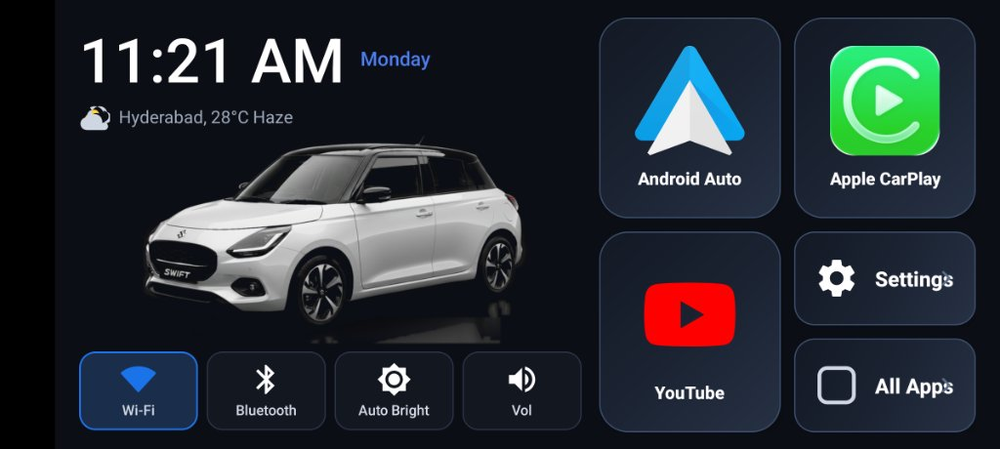

# DashFlow — Lightweight OEM Car Launcher (Android 8.0+ & 1GB–2GB RAM Optimized)

<div align="center">

[](LICENSE)
[](https://github.com/HarideepS/DashFlow/actions/workflows/android-build.yml)
[](#)
[](#)
[](#)

<br/><br/>



<br/><br/>

**DashFlow** is a lightweight, zero-bloat, OEM-styled Android Car Launcher built specifically for low-resource aftermarket Android head units (1GB–2GB RAM running Android 8.0+) as well as your tablet/phone repurposed as a car display — **fully customizable for any vehicle!**

</div>

---

## 🧠 Architecture & Zero-Bloat Engineering

Most aftermarket head-unit launchers trigger Android's **Low Memory Killer (LMK)** during heavy navigation or CarPlay/Android Auto streaming because they embed WebViews, heavy animation loops, or bloated SDKs. DashFlow takes a strict constraint-first approach:

* **Pure Native Views (`ConstraintLayout` + ViewBinding + Vector Drawables)**: No Jetpack Compose runtime, no Flutter engine, no WebViews, and zero analytics or Google Play Services SDKs.
* **Memory-Safe Custom Media**: User-uploaded car photos are downsampled via `inJustDecodeBounds` / `inSampleSize` before decoding, keeping footprint lean even on 1GB RAM hardware.
* **Verify Memory Footprint Yourself**: Connect your head unit or tablet/phone via ADB and inspect resident PSS memory:
  ```bash
  adb shell dumpsys meminfo com.automotive.swiftlauncher
  ```

---

## 🚗 Key Features & Dashboard Customization

### 1. 🚘 Universal Vehicle Dashboard Customizer
Tap the car image or the vehicle badge at any time (or long-press the **Settings** card) to launch the in-cockpit Customizer:
* **Custom Vehicle Model & License Plate**: Personalize your ride's model name and optional registration plate badge directly on the dashboard.
* **Built-in Silhouette Presets**: Switch instantly between **Swift OEM**, **Sport Sedan**, **Urban SUV**, **Sports GT**, and **Cyber EV**.
* **Upload Any Custom Car Photo / PNG**: Pick any photo of your own car from device storage/gallery with automatic memory-safe downsampling.
* **Accent Colors & Scaling**: Choose custom cockpit accent colors (`Blue`, `Cyan`, `Green`, `Red`, `Amber`) and vehicle scale (`85% Compact`, `100% Default`, `115% Hero`).

### 2. 🏎️ Raw GPS Speedometer (Zero Play Services)
* Uses native Android `LocationManager` (`GPS_PROVIDER`) with zero Google Play Services dependencies so it works smoothly on de-bloated head units.
* Displays a live digital speed pill in **KM/H** or **MPH** (tap the speed pill anytime to switch units).

### 3. 🎵 Headless Media Controller (`MediaSessionManager`)
* Reads active playback sessions from Spotify, YouTube Music, Poweramp, etc. via a lightweight `NotificationListenerService`.
* Automatically appears above the quick controls bar only while media is active, providing blind-touch-friendly **Previous**, **Play/Pause**, and **Next** buttons plus hardware media-key support (`KEYCODE_MEDIA_*`).

### 4. ⛅ Geocoded Weather & Sunrise/Sunset Auto-Dimming
* **Live Weather Pill**: Resolves any configured city name automatically via Open-Meteo's free Geocoding + Forecast APIs (no API key required) with offline cache fallback.
* **Zero-Sensor Auto-Dimming**: Optional sunrise/sunset brightness adjustment using cached solar timestamps from Open-Meteo, ideal for budget head units that lack an ambient light sensor.

### 5. 🎯 Direct Driving Cards & Cold-Boot Recovery
1. **Android Auto**: Default maps to `io.github.slashmax.openheadunit` (Wi-Fi Direct launch for your tablet/phone).
2. **Apple CarPlay**: Default maps to `com.zjinnova.zlink` (ZLink wireless/wired CarPlay).
3. **YouTube**: Maps to YouTube / ReVanced / NewPipe.
4. **Settings & All Apps**: Direct access to system settings and an instant-search app drawer.
* **Smart App Re-Binding**: Long-press any driving card to assign it to any installed app on your unit (ideal if your head unit uses custom package names like `cn.manstep.phonemirrorbox` or `com.syu.zlink`).
* **Cold-Boot Auto-Launch**: Optional `BOOT_COMPLETED` / `QUICKBOOT_POWERON` receiver lets you automatically launch your preferred CarPlay/AA or navigation app right after ignition.

---

## 🛠️ How to Download, Build & Install

### 📦 Pre-Built APK (Recommended for Drivers)
Download the latest ready-to-install `.apk` directly from the **[GitHub Releases](https://github.com/HarideepS/DashFlow/releases)** page (automatically built by GitHub Actions on every release tag) — no Android Studio required!

---

### 🔨 Build from Source

#### Open with Android Studio
1. Open Android Studio.
2. Select **Open** and choose this project folder.
3. Let Gradle sync and click **Build -> Build Bundle(s) / APK(s) -> Build APK(s)** (or run `./gradlew assembleDebug` in terminal).
4. The generated APK will be in:
   ```
   app/build/outputs/apk/debug/app-debug.apk
   ```

---

### 📲 Install

Sideload the `.apk` onto your Android head unit or your tablet/phone using any of the following methods:

#### Option A: Via LocalSend (Wireless File Transfer — Recommended)
1. Install **[LocalSend](https://localsend.org/)** on both your phone/PC and your Android head unit (or your tablet/phone).
2. Ensure both devices are connected to the same Wi-Fi network or mobile hotspot.
3. Open LocalSend on your phone/PC, select the APK file, and send it to your head unit.
4. Accept the incoming transfer on your head unit, tap the received APK, and select **Install**.

#### Option B: Via USB Flash Drive
1. Copy the `.apk` onto a standard FAT32 USB flash drive.
2. Plug it into one of your head unit's USB ports.
3. Open the built-in **"File Manager"** or **"ApkInstaller"** on your head unit.
4. Tap the APK and select **Install**.

#### Option C: Via ADB (USB or Wi-Fi)
```bash
adb install -r app-debug.apk
```

---

## ⚙️ Setting as Default Home Screen

1. On your head unit or tablet/phone, open **Settings**.
2. Go to **Apps & notifications** -> **Default apps** -> **Home app**.
3. Select **DashFlow**.
4. Press the Home button on your head unit / navigation bar; it will now permanently open your custom OEM cockpit!

---

## 🤝 Contributing & License

* Contributions are welcome! Read [CONTRIBUTING.md](CONTRIBUTING.md) for architecture guidelines and good first issues.
* Licensed under the **[MIT License](LICENSE)**.
* Initial prototype & iterative development powered by Google Antigravity.
